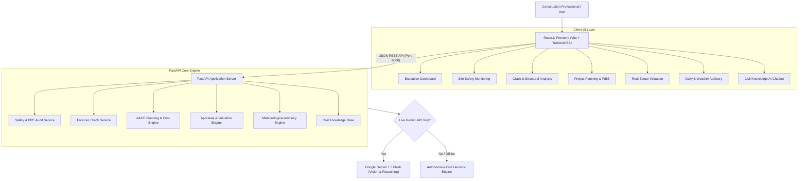

# AI-Powered Multimodal Construction Intelligence Platform

A full-stack, multimodal decision-support system designed to assist civil engineers, project directors, site safety officers, and real estate appraisers across all stages of construction planning, execution, structural inspection, and monitoring.

---

## 🏗️ Architecture & Modules Overview

The platform is designed around strict JSON-based data contracts, combining a high-performance **FastAPI (Python 3.11)** backend with an interactive **React.js 18 (Vite + TailwindCSS)** frontend, powered by **Google Gemini 1.5 Multimodal AI** with an autonomous offline civil engineering fallback engine.



---

## 🚀 Key Features by Epic

### 1. Construction Site Safety Monitoring (Epic 2)
- **PPE Verification**: Identifies Hardhats (ANSI Z89.1), Hi-Vis Vests (Class 2/3), Steel-Toed Boots, Gloves, and Eye Protection.
- **Hazard Identification**: Elevated work without harness tie-off, missing scaffolding mid-rails/toe-boards, and unshored deep excavations.
- **OSHA 1926 Scoring**: Quantitative safety compliance index (0–100) with color-coded risk levels.
- **Corrective Action Roadmap**: Immediate step-by-step mitigation instructions and OSHA code citations.

### 2. Forensic Crack & Structural Distress Analysis (Epic 2)
- **Defect Classification**: 45° diagonal shear cracks, column spalling with exposed rebar, and partition plaster shrinkage cracks.
- **Dimensional Telemetry**: Real-time extraction of estimated width (mm), length (cm), orientation, and penetration depth.
- **Structural Integrity Risk**: Load-bearing capacity impact analysis and propagation hazard rating.
- **ACI 224.1R Remediation**: Carbon Fiber Reinforced Polymer (CFRP) wrapping, low-viscosity pressure epoxy injection, and propping requirements.

### 3. Construction Project Planning & Cost Estimation (Epic 3)
- **Automated Work Breakdown Structure (WBS)**: 6 synchronized phases from Pre-Construction to Handover.
- **Milestone Timeline**: Gantt-ready schedule tracking durations, start/end weeks, and Critical Path activities.
- **Cost Allocation**: Categorized breakdown across Civil works, MEP services, Finishes, Equipment, Labor, and Contingency fund.
- **Manpower Scheduling**: Trade allocations with peak headcounts, daily rates, and estimated total man-days.

### 4. Real Estate Valuation & Investment Intelligence (Epic 3)
- **Cost-Approach Appraisal**: Separation of underlying land value capitalization from depreciated structural replacement cost.
- **Straight-Line Age-Life Depreciation**: Industry-standard physical wear calculations.
- **Comparative Market Analysis (CMA)**: Benchmarking against recent local property transactions.
- **Investment Metrics**: Capitalization rate, estimated monthly rental yield, and 5-year capital appreciation forecast.

### 5. Daily Site Assistance & Weather-Aware Advisory (Epic 5)
- **Meteorological Impact Matrix**: Evaluation of temperature, wind velocity, humidity, and precipitation.
- **Critical Activity Feasibility**: Concrete placing feasibility, tower crane wind speed cutoffs (>38 km/h), and excavation slope stability.
- **Shift Safety Checklist**: Checkable supervisor tasks categorized by Safety, Quality, and Weather Defense.
- **Material Storage Safeguards**: Elevated pallet guidelines, moisture barriers, and rebar corrosion prevention.

### 6. Construction Knowledge Assistant (Epic 5)
- **Interactive Conversational AI**: Instant answers to technical queries, mix design calculations (M10 to M50), and ASTM/IS code standards.
- **Prompt Suggestions**: One-click technical queries with rich Markdown responses and reference citations.

---

## 🛠️ Quick Start & Running the Project

### Option A: One-Click Launch (Recommended for Windows)
Simply double-click:
```bat
run_all.bat
```
This automatically starts the FastAPI backend, starts the Vite React frontend, and opens `http://localhost:5173` in your default browser.

### Option B: Manual Terminal Execution

#### 1. Backend (FastAPI)
```powershell
# In project root:
$env:PYTHONPATH = "."
python -m uvicorn backend.main:app --host 127.0.0.1 --port 8000 --reload
```
- API Base: `http://127.0.0.1:8000`
- Interactive Swagger UI: `http://127.0.0.1:8000/docs`

#### 2. Frontend (React + Vite)
```powershell
cd frontend
npm run dev
```
- Open `http://localhost:5173`

---

## 🧪 Automated Testing

A comprehensive test suite covering all services, schemas, and endpoints is located in `backend/tests/`:

```powershell
$env:PYTHONPATH = "."
pytest backend/tests -v
```

All 11 unit & integration tests pass with 100% success:
- `test_health`: System operational status
- `test_project_stats`: Epics & task status
- `test_sample_presets`: Image presets
- `test_safety_service_compliant`: PPE & safety scoring
- `test_safety_service_excavation_hazard`: Cave-in detection
- `test_crack_service_shear_beam`: Diagonal shear crack evaluation
- `test_crack_service_spall_column`: Column spall & rebar damage
- `test_planning_service`: WBS, milestones & cost breakdowns
- `test_valuation_service`: Appraisal & rental yield calculation
- `test_advisory_service`: Weather risk & crane cutoff rules
- `test_assistant_service`: Code standards query resolution

---

## 🔑 AI Engine Configuration

The application works **100% out of the box** without requiring any API keys.
If you wish to enable live Google Gemini 1.5 Multimodal model calls:
1. Click the **"Autonomous Civil AI / Settings"** button in the top right of the navigation bar.
2. Enter your Google Gemini API key.
3. Click **"Save Configuration"** (the key is stored securely in your browser's `localStorage` and sent via `X-Gemini-API-Key` headers).
4. Alternatively, set `GEMINI_API_KEY=your_key_here` in `backend/.env`.

---

## 📋 Technology Stack
- **Backend**: FastAPI, Python 3.11, Pydantic v2, Uvicorn, Pillow, Requests, Pytest
- **Frontend**: React 18, Vite, TailwindCSS, Lucide-React, Recharts
- **AI Models**: Google Gemini 1.5 Flash (REST API JSON mode) + Autonomous Civil Heuristic Engine
